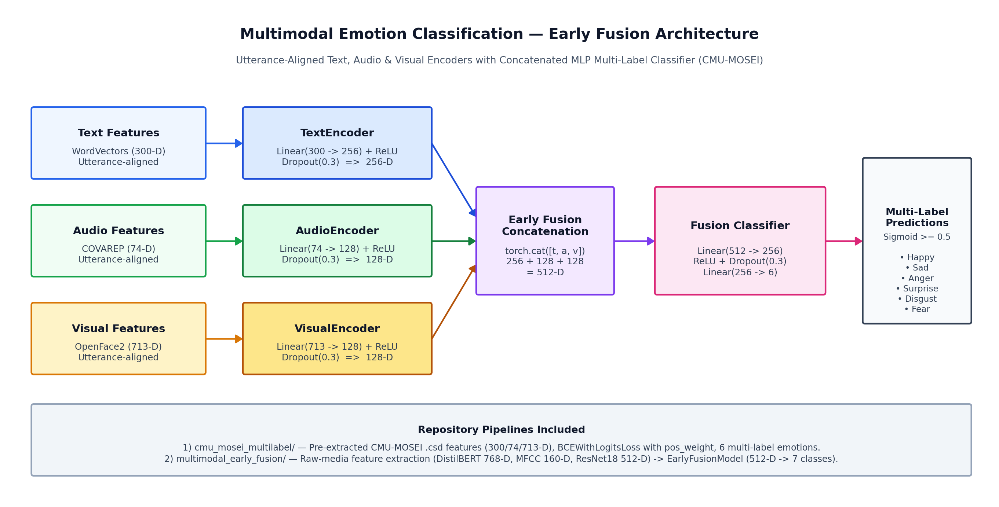
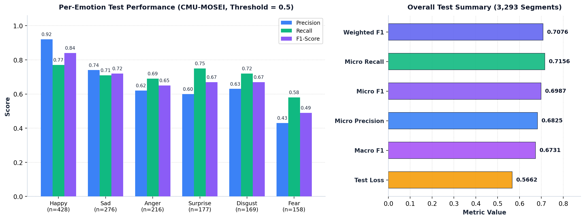

# Multimodal Emotion Classification

A PyTorch multimodal emotion classification project combining text, audio, and visual modalities through dedicated encoders and an early-fusion neural architecture.

## Project Structure

- **`cmu_mosei_multilabel/`** — Multi-label multimodal emotion classification pipeline on the CMU-MOSEI dataset (6 emotion classes: `happy`, `sad`, `anger`, `surprise`, `disgust`, `fear`).
- **`multimodal_early_fusion/`** — Feature-extraction and early-fusion classification pipeline (7 classes using DistilBERT text, MFCC audio, and ResNet18 visual features).
- **`figures/`** — Overview diagram, model architecture diagram, and CMU-MOSEI evaluation plots.
- **`Multimodal Emotion Classification.pptx`** — Project presentation slides.

---

## Overview & Architecture




---

## Evaluation Results (`cmu_mosei_multilabel/`, CMU-MOSEI)



| Metric | Value |
|---|---|
| **Test Loss** | `0.5662` |
| **Micro F1** | `0.6987` |
| **Macro F1** | `0.6731` |
| **Weighted F1** | `0.7076` |
| **Micro Precision** | `0.6825` |
| **Micro Recall** | `0.7156` |

---

## 1. CMU-MOSEI Multi-Label Pipeline (`cmu_mosei_multilabel/`)

### Setup
```bash
cd cmu_mosei_multilabel
python -m venv .venv
.venv\Scripts\activate
pip install -r requirements.txt
```

### Dataset Preparation
Place the CMU-MOSEI `.csd` files inside `cmu_mosei_multilabel/data/csd/`:
- `CMU_MOSEI_Labels.csd`
- `CMU_MOSEI_TimestampedWordVectors.csd`
- `CMU_MOSEI_COVAREP.csd`
- `CMU_MOSEI_VisualOpenFace2.csd`

Extract aligned features and train/validation/test splits:
```bash
python prepare_mosei_multilabel_from_csd.py --csd_dir data/csd --out_dir data/processed
```

Update `TEXT_DIM`, `AUDIO_DIM`, and `VISUAL_DIM` in `cmu_mosei_multilabel/config.py` to match the generated `data/processed/feature_dims.json` if needed, then train and evaluate:
```bash
python train.py
python evaluate.py
```

---

## 2. Early-Fusion Feature Extraction Pipeline (`multimodal_early_fusion/`)

1. Download the dataset referenced in `multimodal_early_fusion/data/source.txt` into `multimodal_early_fusion/data/` (keeping `data/processed/` intact).
2. Run metadata creation, feature extraction, training, and evaluation:
```bash
cd multimodal_early_fusion
python build_metadata.py
python split_data.py
python scripts/extract_text_features.py
python scripts/extract_audio_features.py
python scripts/extract_visual_features.py
python train.py
python evaluate.py
```
